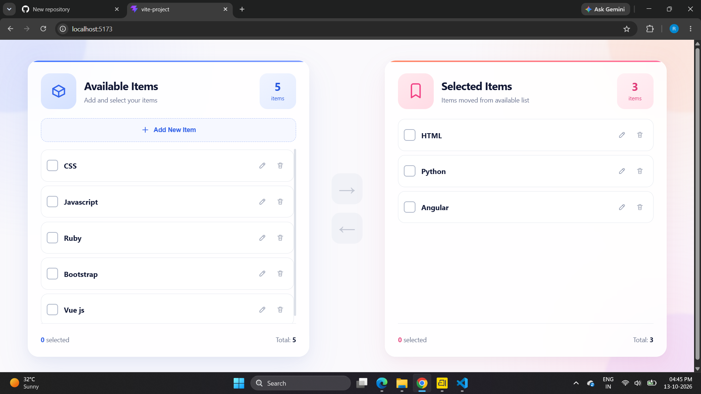
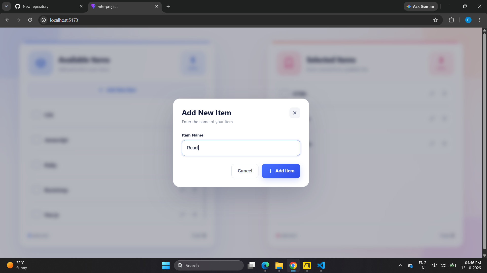
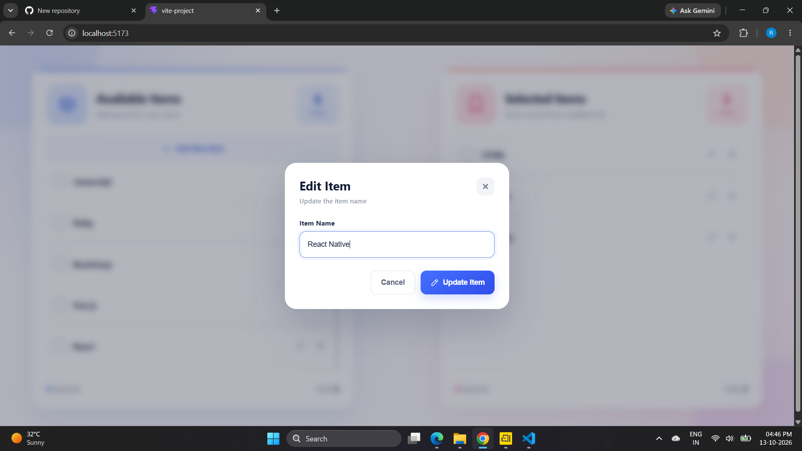
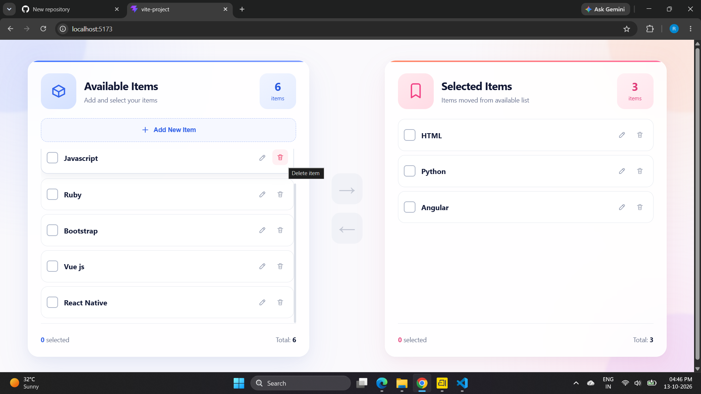
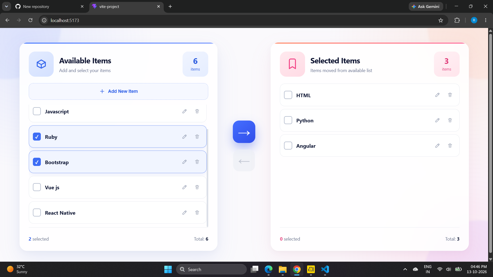
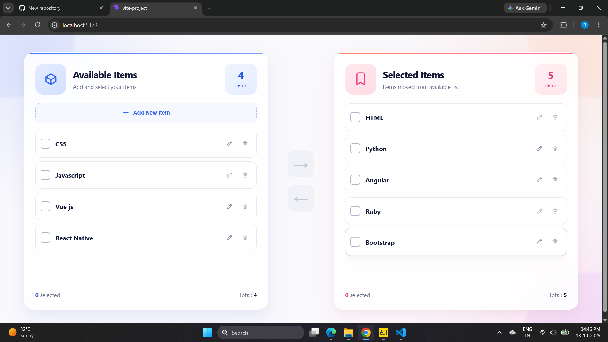

# Available Items & Selected Items Manager

A React and Vite application for managing two lists of items. Add new items, select one or multiple entries, move them between lists, edit their names, and delete entries through a clean, interactive interface.

## Screenshots

### Main interface

The application displays Available Items and Selected Items in separate panels. Item totals and selected-item counts update as you interact with the lists.



### Moving items between lists

Select items with their checkboxes, then use the arrow controls between the panels to move them to the other list.



### Add a new item

Use **Add New Item** to open the dialog, enter an item name, and add it to the available list.



### Edit an item

Use the edit control beside an item to update its name.



### Item actions

Items include controls for editing and deleting them.



### Select multiple items

Checkboxes allow multiple items to be selected before moving them together.



## Features

- Add custom items to the available list.
- Edit an existing item's name.
- Delete items from either list.
- Select one or more items with checkboxes.
- Move selected items in either direction using arrow buttons.
- Display live item totals and selection counts.
- Modal dialogs for adding and editing items.
- Responsive, light-themed interface built with CSS.

## Built With

- React
- JavaScript (ES6+)
- Vite
- HTML
- CSS
- React Hooks (for component state and interactions)

## Project Structure

```text
box/
├── public/
├── src/
│   ├── assets/
│   ├── images/
│   │   ├── drag1.png
│   │   ├── drag2.png
│   │   ├── drag3.png
│   │   ├── drag4.png
│   │   ├── drag5.png
│   │   └── drag6.png
│   ├── App.jsx
│   ├── App.css
│   ├── index.css
│   └── main.jsx
├── index.html
├── package.json
├── package-lock.json
└── README.md
```


## Getting Started

### 1. Open the project directory

```bash
cd box
```

### 2. Install dependencies

```bash
npm install
```

### 3. Start the development server

```bash
npm run dev
```

### 4. Open the local URL

Vite prints the local development URL in the terminal. It is commonly:

```text
http://localhost:5173
```

## How to Use

1. Review the items in **Available Items**.
2. Click **Add New Item** to create an item.
3. Select one or more items using the checkboxes.
4. Click the right arrow to move selected items to **Selected Items**.
5. Select items in the right panel and click the left arrow to move them back.
6. Use the edit control to rename an item.
7. Use the delete control to remove an item.
8. Check the panel counters to see the current totals and selected counts.

## How It Works

The interface keeps the two lists and checkbox selections in React state. User actions update that state, and React re-renders the affected lists and counters. Moving an item removes it from one list and adds it to the other, so it is not duplicated across both lists.

## Possible Enhancements

- Persist the lists in `localStorage` so they remain after a page refresh.
- Add search and filtering.
- Add drag-and-drop between panels.
- Add a confirmation step before deleting an item.

## License

This project is intended for learning and demonstration purposes. Add a license file if you plan to distribute it publicly.
